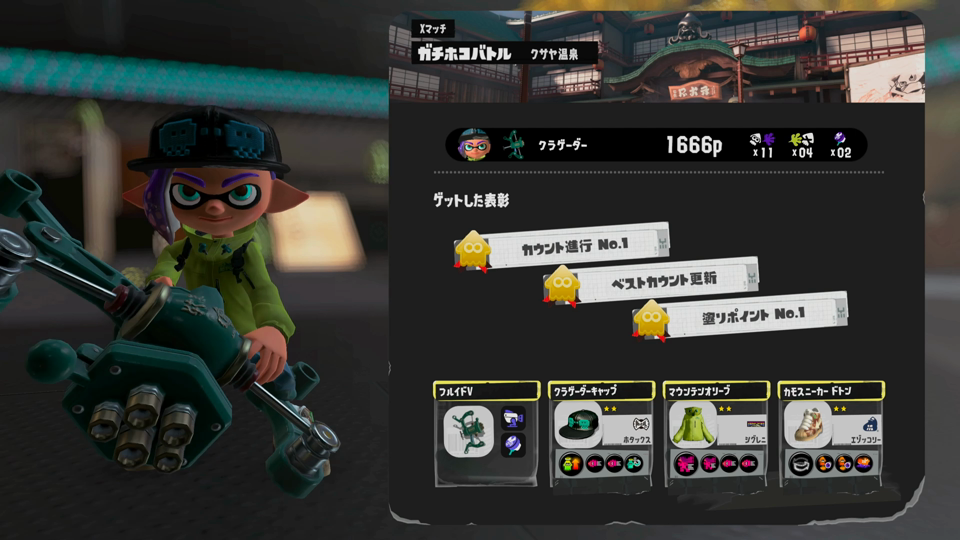
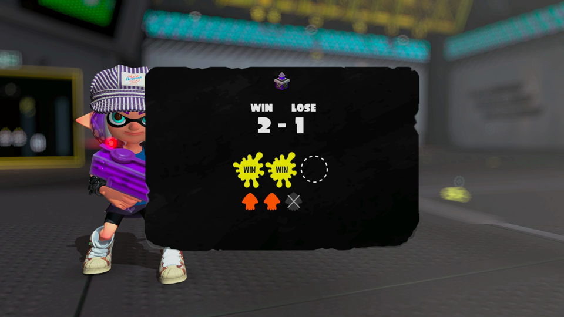

# Xパワー読み取り（#133）調査メモ

調査日：2026-10-25 JST（branch feat/x-power-read、ドラフトPR #153）

## 結論
手元の Xマッチ録画 6 本では、**Xパワーの数値が画面に一度も出ていない**。正解データを動画から作れないため、読み取りの実装・検証は保留し、仕様の確認をユーザー側に依頼した。

## 確認した録画と画面
| 録画 | 結果 | 試合後の計測ボックス（WIN-LOSE） | Xパワー表示 |
|---|---|---|---|
| 2026-10-18 22-15-50_match03 ガチヤグラ | WIN | 0-0 → 1-0 | なし |
| 2026-10-18 22-15-50_match04 ガチヤグラ | WIN | 1-0 → 2-0 | なし |
| 2026-10-18 22-15-50_match05 ガチヤグラ | LOSE | 2-0 → 2-1 | なし |
| 2026-10-18 23-23-22_match01 ガチホコ | WIN | 0-0 → 1-0 | なし |
| 2026-10-18 23-23-22_match02 ガチホコ | LOSE | 1-0 → 1-1 | なし |
| 2026-10-18 23-23-22_match03 ガチホコ | WIN | 1-1 → 2-1 | なし |

各録画で確認した場面：
- 録画の先頭（ロビーのマッチメイク中、ルール紹介） — Xパワーなし。
- 個人リザルト（ヘッダー「Xマッチ」・ルール・ステージ） — 塗りポイント（p）、キル・アシスト／デス／スペシャル、表彰、ギアのみ。Xパワーなし。
- その直後の黒いボックス（WIN／LOSE の計測進行、丸3つ＋イカ3つ） — 勝敗数だけ。Xパワーなし。
- その後のバッジ・ランク画面、チーム成績表 — Xパワーなし。

どの録画も計測（3勝または3敗）が終わっていないため、計測終了時に出ると考えられる Xパワー画面は録画に含まれていない。

## ユーザー側に確認したいこと
1. Xパワーをどの画面から読むか（計測終了時の画面か、ロビーのメニュー等か）。その画面が映った録画を用意できるか。
2. 計測途中の Xマッチ（今回の 6 本はすべてこれ）は `power.status` を何にするか。
   - 案A：`not_shown`（画面に出ていない＝現状のまま）
   - 案B：計測終了の試合だけ `acquired`、途中は `not_shown`
   - 案C：計測終了時の値を、同じ計測の前の試合（最大5試合）にもさかのぼって付ける
3. 「未表示（not_shown）」と「読取失敗（read_failed）」の切り分けは、Xパワー画面の実録画で確認してから決める（#133 の方針どおり）。

p（塗りポイント）は Xパワーとして使わない。現状の `powerForMatchType()` は Xマッチで `not_shown` を返すので、誤読はしていない。
